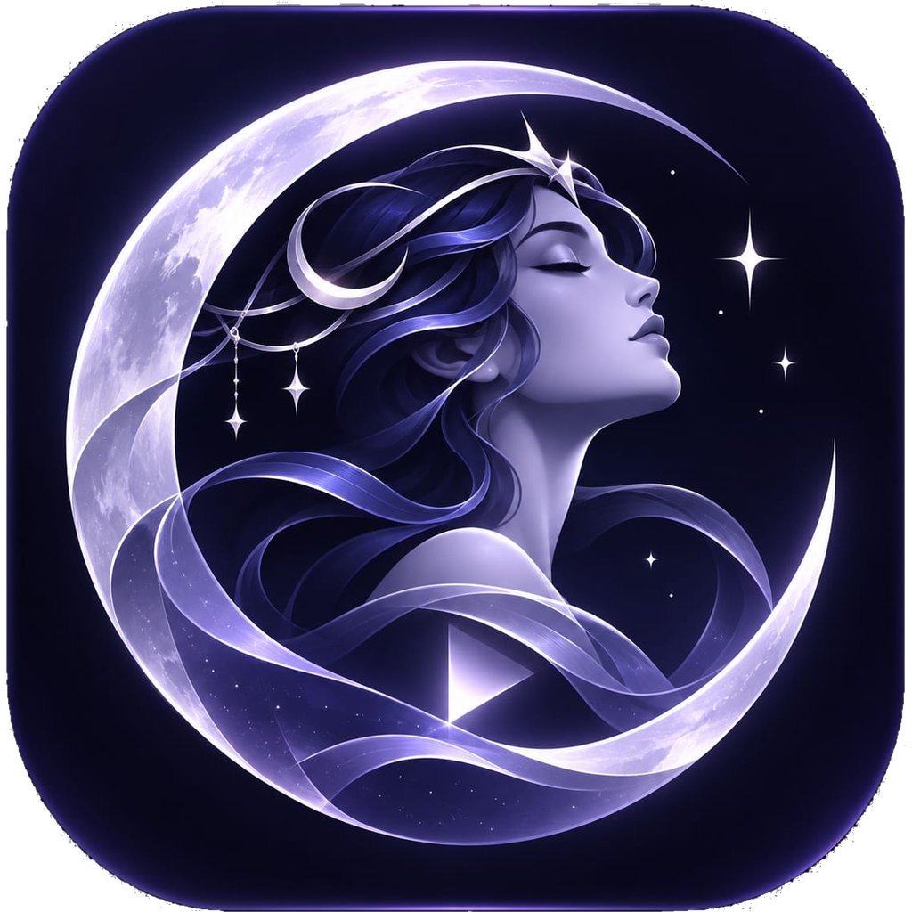

# NyxPlay for PC

Desktop client of [NyxPlay](../README.md) for Windows, macOS, Linux and Steam Link. It streams from
[NyxPlay Host](../host), [Apollo](https://github.com/ClassicOldSong/Apollo), [Sunshine](https://github.com/LizardByte/Sunshine)
and NVIDIA GameStream.

NyxPlay for PC is based on [Moonlight PC](https://github.com/moonlight-stream/moonlight-qt) by the Moonlight
Game Streaming Project.

| | |
|---|---|
| Executable | `NyxPlay.exe` (Windows), `nyxplay` (Linux), `NyxPlay.app` (macOS) |
| Version | `2026.11.11.1` |
| Settings | Organization `NyxPlay` (separate from Moonlight) |

NyxPlay changes: branding, NyxPlay colour scheme, own update manifest (`deploy/updates/qt.json`),
independent installer identity, Discord Rich Presence disabled by default (it is bound to Moonlight's
Discord application) and the NyxPlay text input extension in the protocol core.

## Features
 - Hardware accelerated video decoding on Windows, Mac, and Linux
 - H.264, HEVC, and AV1 codec support (AV1 requires Sunshine and a supported host GPU)
 - YUV 4:4:4 support (Sunshine only)
 - HDR streaming support
 - 7.1 surround sound audio support
 - 10-point multitouch support (Sunshine only)
 - Gamepad support with force feedback and motion controls for up to 16 players
 - Support for both pointer capture (for games) and direct mouse control (for remote desktop)
 - Support for passing system-wide keyboard shortcuts like Alt+Tab to the host
 
## Building

### Windows Build Requirements
* Qt 6.11 SDK or later (earlier versions may work but are not officially supported)
* [Visual Studio 2026](https://visualstudio.microsoft.com/downloads/) (Community edition is fine)
* Select **MSVC** option during Qt installation. MinGW is not supported.
* [7-Zip](https://www.7-zip.org/) (only if building installers for non-development PCs)
* Graphics Tools (only if running debug builds)
  * Install "Graphics Tools" in the Optional Features page of the Windows Settings app.
  * Alternatively, run `dism /online /add-capability /capabilityname:Tools.Graphics.DirectX~~~~0.0.1.0` and reboot.

### macOS Build Requirements
* Qt 6.11 SDK or later (earlier versions may work but are not officially supported)
* Xcode 15 or later (earlier versions may work but are not officially supported)
* [create-dmg](https://github.com/sindresorhus/create-dmg) (only if building DMGs for use on non-development Macs)

### Linux/Unix Build Requirements
* Qt 6 is recommended, but Qt 5.12 or later is also supported (replace `qmake6` with `qmake` when using Qt 5).
* GCC or Clang
* FFmpeg 4.0 or later
* Install the required packages:
  * Debian/Ubuntu:
    * Base Requirements: `libegl1-mesa-dev libgl1-mesa-dev libopus-dev libsdl2-dev libsdl2-ttf-dev libssl-dev libavcodec-dev libavformat-dev libswscale-dev libva-dev libvdpau-dev libxkbcommon-dev wayland-protocols libdrm-dev`
    * Qt 6 (Recommended): `qt6-base-dev qt6-declarative-dev libqt6svg6-dev qt6-wayland qml6-module-qtquick-controls qml6-module-qtquick-templates qml6-module-qtquick-layouts qml6-module-qtqml-workerscript qml6-module-qtquick-window qml6-module-qtquick`
    * Qt 5: `qtbase5-dev qt5-qmake qtdeclarative5-dev qtquickcontrols2-5-dev qml-module-qtquick-controls2 qml-module-qtquick-layouts qml-module-qtquick-window2 qml-module-qtquick2 qtwayland5`
  * RedHat/Fedora (RPM Fusion repo required):
    * Base Requirements: `openssl-devel SDL2-devel SDL2_ttf-devel ffmpeg-devel libva-devel libvdpau-devel opus-devel pulseaudio-libs-devel alsa-lib-devel libdrm-devel`
    * Qt 6 (Recommended): `qt6-qtsvg-devel qt6-qtdeclarative-devel`
    * Qt 5: `qt5-qtsvg-devel qt5-qtquickcontrols2-devel`
* Building the Vulkan renderer requires a `libplacebo-dev`/`libplacebo-devel` version of at least v7.349.0 and FFmpeg 6.1 or later.

### Steam Link Build Requirements
* [Steam Link SDK](https://github.com/ValveSoftware/steamlink-sdk) cloned on your build system
* STEAMLINK_SDK_PATH environment variable set to the Steam Link SDK path

**Steam Link Hardware Limitations**  
NyxPlay builds for Steam Link are subject to hardware limitations of the Steam Link device:
* Maximum resolution: **1080p (1920x1080)**
* Maximum framerate: **60 FPS**
* Maximum video bitrate: **40 Mbps**
* **HDR streaming is not supported** on the original hardware

### Docker containers
If you want to use Docker for building, look at [this repo](https://github.com/cgutman/moonlight-packaging) containing canonical containers
for different architectures, which handle building deps and extra linking for you.

### Build Setup Steps
1. Install the latest Qt SDK (and optionally, the Qt Creator IDE) from https://www.qt.io/download
    * You can install Qt via Homebrew on macOS, but you will need to use `brew install qt --with-debug` to be able to create debug builds of NyxPlay.
    * You may also use your Linux distro's package manager for the Qt SDK as long as the packages are Qt 5.12 or later.
    * This step is not required for building on Steam Link, because the Steam Link SDK includes Qt 5.14.
2. Download submodules and dependencies
    * Run `git submodule update --init --recursive` from within `pc/`.
    * On Windows and macOS, you must also run `setup-deps.ps1` (Windows) or `setup-deps.py` (macOS).
    * Perform these steps each time you pull new changes from the Git repository.
3. Open the project in Qt Creator or build from qmake on the command line.
    * To build a binary for use on non-development machines, use the scripts in the `scripts` folder.
        * For Windows builds, use `scripts\build-arch.bat` and `scripts\generate-bundle.bat`. Execute these scripts from the root of the repository within a Qt command prompt. Ensure  7-Zip binary directory is on your `%PATH%`.
        * For macOS builds, use `scripts/generate-dmg.sh`. Execute this script from the root of the repository and ensure Qt's `bin` folder is in your `$PATH`.
        * For Steam Link builds, run `scripts/build-steamlink-app.sh` from the root of the repository.
    * To build from the command line for development use on macOS or Linux, run `qmake6 moonlight-qt.pro` then `make debug` or `make release`.
        * The final binary will be placed in `app/nyxplay`.
    * To create an embedded build for a single-purpose device, use `qmake6 "CONFIG+=embedded" moonlight-qt.pro` and build normally.
        * This build will lack windowed mode, Discord/Help links, and other features that don't make sense on an embedded device.
        * For platforms with poor GPU performance, add `"CONFIG+=gpuslow"` to prefer direct KMSDRM rendering over GL/Vulkan renderers. Direct KMSDRM rendering can use dedicated YUV/RGB conversion and scaling hardware rather than slower GPU shaders for these operations.

## Credits

NyxPlay for PC is built on Moonlight PC by [Cameron Gutman](https://github.com/cgutman) and the Moonlight
Game Streaming Project. Licensed under the GNU GPL v3 ([LICENSE](LICENSE)); see [CREDITS.md](../CREDITS.md).
